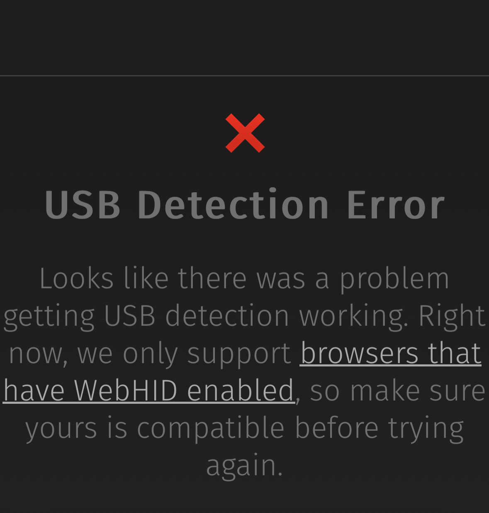
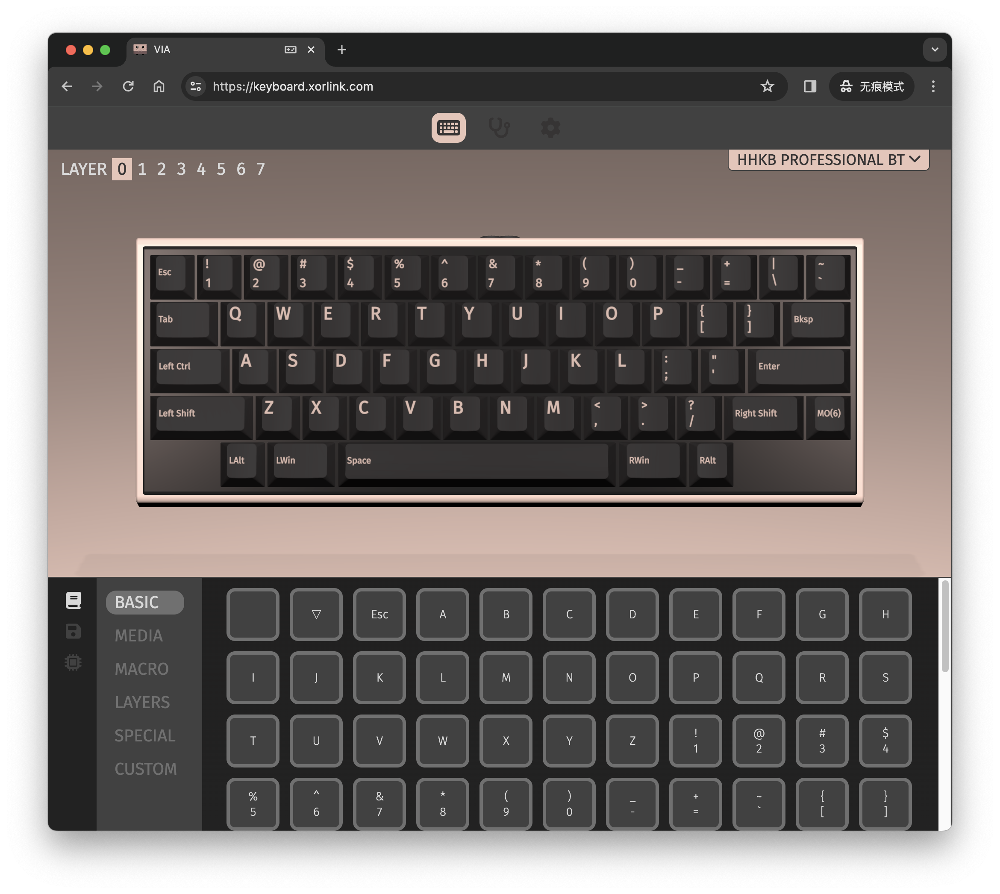
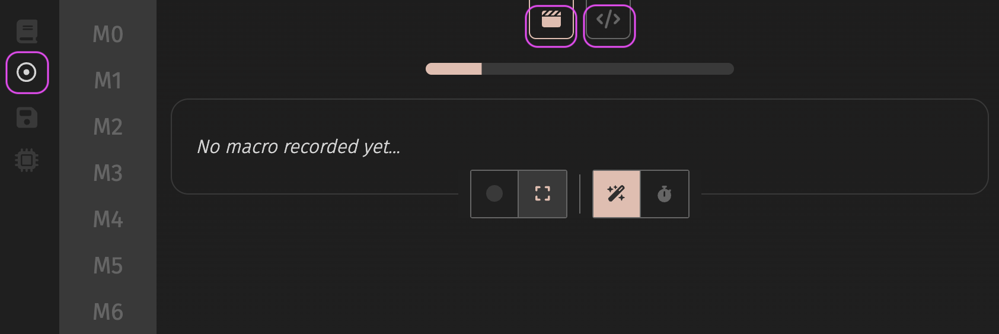
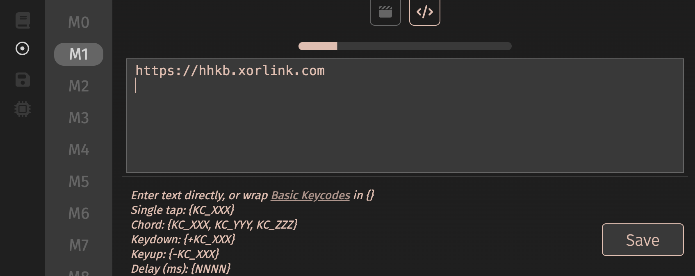
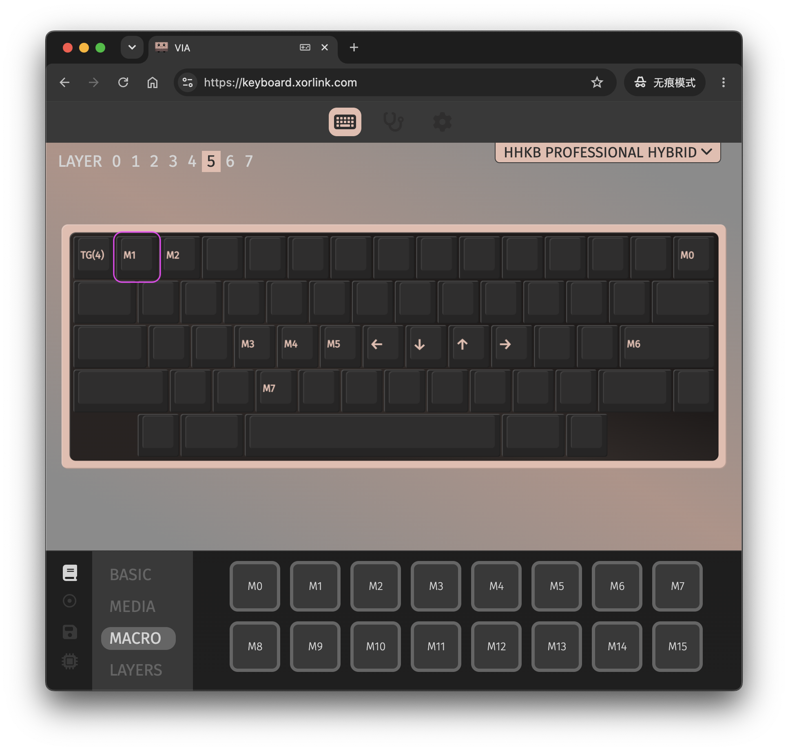
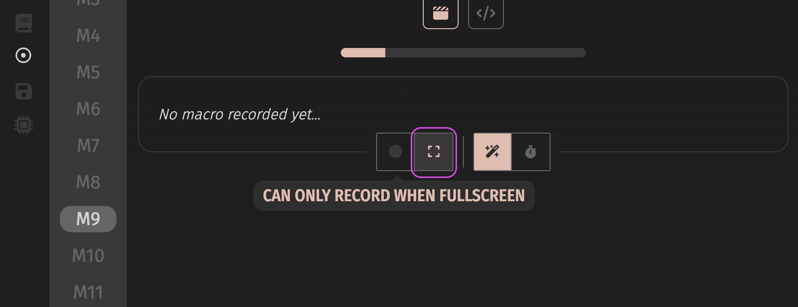
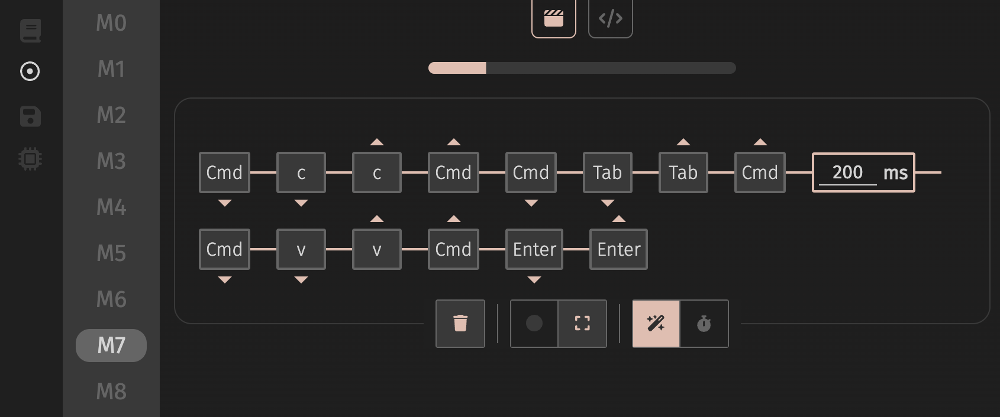

# 键位自定义
HHKB QMC 除了支持传统的 USB 有线 VIA 改键外，还支持无线 VIA 改键。有线和无线模式下的改键操作均相同。

改装后的 HHKB 键盘，原先背部的 DIP 开关将失效。现在可通过 Web App，以图形交互的方式，实现全局键位的实时更新。

这里使用的 App 是一个名为 VIA 的[开源项目](https://github.com/the-via/app)，感谢作者的开源。

## 准备
1. 更新键盘固件，需 V1.3.0 及以上版本固件。
2. 浏览器跟键盘进行通讯，会使用到一个高级功能，目前仅 Chrome、Edge、Opera 的较新版本支持此功能。意味着接下来的操作，你需要在上述几款浏览器下进行。

## 入门
1. 访问 [改键主页](https://keyboard.xorlink.com)，第一次访问较慢，请耐心等待。

    如果出现以下提示，说明当前使用的浏览器不支持一先提到的高级功能，请更换浏览器或升级到最新版本。

2. 键盘通过 USB 线或者蓝牙连接到 PC，确保键盘被操作系统正确识别。
3. 网页上点击 “Authorize device” 按钮，此时弹出一个对话框，显示我们的设备 “HHKB Professional”。（⚠️：Windows 下因系统原因，在蓝牙连接方式下会显示为 Unknown Device）
4. 选中 ”HHKB Professional“，点击“连接”按钮，进入到改键页面，如下图。

页面上方展示的是键盘及当前键位，左上角 LAYER 序号可切换键位层，共八层。页面下方展示的是可设置的键值。

改键操作很简单，首先页面上方选中需要修改的按键，然后下方点击目标键值，随即便完成了改键。整个改键交互是实时的，当你操作完成后，关闭网页即可。

⚠️ 新键位会在键盘进入自动睡眠时自动保存。你也可以在界面左下角的 `CONFIG` 菜单下的 `SAVE` 子菜单中手动操作立即保存当前配置。

## 进阶
页面左下角，有 BASIC、MEDIA、MACRO、LAYERS、SPECIAL、CUSTOM 几个菜单。下面逐一介绍。
### BASIC
最常用的按键。
### LAYERS
层切换键。

`Space Fn` 为 Tap-Hold 键。Tap 是轻敲，Hold 是保持的意思。对应到我们键盘的按键操作，敲击 `Space` 是空格，长按 `Space` 切换层。

`MO(n)` 表示按下此键并保持时，键位会切换到第 n 层。当按键释放后，又切换回当前层。注意最下面一层为第 0 层。

以默认的第 0 层为例，右下角按键被设置为 MO(6)，按下此键，键位会立即切换到第 6 层，此时最上面一排的数字键变成了 F 键。释放后，键位又恢复为第 0 层。

这里需要特别注意：第 0 层 MO(6) 对应的按键在第 6 层为一个倒三角符号。这个符号表示 Transparent -- 透明的。即沿用下一层的功能。

为什么要这样设置呢？因为当按住 MO(6) 时，键位切换到第 6 层，此时该键仍为 MO(6)，保持不变，即一直停留在该层。然后我们就可以在保持此键按下的同时按其它键，实现组合键功能。当 MO(6) 释放后，又自动回到第 0 层。一般 MO(n) 的上一层对应按键都需要设置为 Transparent，即倒三角符号，以便在按键释放时能回到之前的层。

`TG(n)` 表示按下该键激活第 n 层键位，再次按下关闭该键位层。 

`TO(n)` 表示按下该键时打开第 n 层键位，同时关闭默认层外的其它层。

`DF(n)` 表示设置第 n 层为默认键位层。

### MEDIA
媒体键。支持音量控制、播放等操作。

### MACRO
支持 16 个自定义宏，总共约 1KB 的宏存储空间，足够应付各种复杂的宏功能。

下面结合两个实际用例，详细介绍 HHKB QMC 的宏功能。

**解决重复输入**

我们平常在使用键盘打字的时候，常常会重复输入一些内容。比如个人邮箱、电话号码等信息。这类信息适合用宏来解决，不仅提高输入效率，还能避免输入错误。

以我平时兼职客服为例。我们 HHKB QMC 的 Wiki 主页为 `https://hhkb.xorlink.com`，这串网址是我经常需要回复给用户的。以前要么手动敲这一长串，要么靠输入法智能提示补全。如今我只需要按一个键，即可完成这一串网址的输入和发送。具体操作如下：

在 VIA 界面的宏设置菜单中，可以自定义 16 个宏。这里有两种设置方式，一种是录制，另一种是直接输入宏内容。如下图：

对于这种一串字符输入，适合直接编辑宏内容。
如下图所示，我们直接将宏 M1 的内容设置为：`https://hhkb.xorlink.com`，并且加了一个回车换行。然后点击右下角的 Save 按钮保存即可。

之后我们回到 Layer5 键值层，将数字键 `1` 绑定为 M1。如下图：

经过上述两步操作后，宏 M1 就设置好了。根据我当前的键位设置（空格键设置为了 `Space Fn5`），只需按住空格键不放，然后再按数字键 1，`https://hhkb.xorlink.com` 这一串字符便会瞬间自动出现在消息输入框中。由于我刚刚在宏的末尾加了一个回车，而回车在聊天界面默认触发发送，于是这一串字符又自动发送了出去。也就是说我一键便完成了这串字符的输入和发送。这样高效的操作效率，也只有宏能够实现。

**解决繁琐操作**

对于经常使用 AI 工具的人来说，`Ctrl+C/V` 这组快捷键的使用频率应该很高。以我的实际应用为例，我需要从 AI 聊天窗口中，将操作命令复制到 Terminal 中执行。在 macOS 下，纯键盘操作是：`Cmd+C` 复制命令 → `Cmd+Tab` 切换到 Terminal → `Cmd+V` 粘贴 → `Enter` 执行。这一套固定流程每天重复几十次，非常繁琐。

而现在我们可以使用宏来一键执行上述繁琐的操作。下面以录制的方式，演示如何进行宏设置。

如下图所示，默认情况下，录制按钮为灰色，提示需要在全屏模式下才能记录。点击录制按钮旁边的全屏按钮进入全屏模式，之后录制按钮点亮，点击即可开始录制。

最终录制结果如下：

每个按键有个向下或向上的箭头，表示按下或释放按键。如果开启了 Record delays 功能（⏱️），两次按键之间的操作间隔也会被记录下来。例如 `Cmd+Tab` 之后建议保留 200ms 左右的延迟，确保窗口切换完成再执行粘贴。

不过需要注意，`Cmd+Tab` 是系统级快捷键，按下后焦点会立刻切走，VIA 录不到后续按键。解决办法是：点一下优化按钮（🪄），这会关闭“智能优化”功能，这样 VIA 会记录每次按下和释放动作。由于不能直接按 `Cmd+Tab`，我们需要手动拼出这个组合。依次在键盘上按 `Cmd`（按下+释放）、`Tab`（按下+释放）、`Cmd`（按下+释放），这样会产生 Cmd↓、Cmd↑、Tab↓、Tab↑、Cmd↓、Cmd↑ 6 个记录。然后我们删掉第 2 个 Cmd↑ 和第 5 个 Cmd↓，剩下的 Cmd↓ → Tab↓ → Tab↑ → Cmd↑，正好是 `Cmd+Tab` 的触发序列。

如果你觉得手动录制有点麻烦，也可以在宏编辑区直接输入 `{KC_LGUI,KC_C}{KC_LGUI,KC_TAB}{200}{KC_LGUI,KC_V}{KC_ENT}` 实现同样的效果。

这里我录制的是 M7（你可以选择任意宏槽位）。录制完成后回到 Layer5， 将按键 C 绑定为 M7。之后只需按住空格再按 C，键盘就会自动完成：复制 → 切换窗口 → 粘贴 → 执行，所有操作一气呵成。

### SPECIAL
特殊功能按键。

#### Any
通过 Any 键值可以设置任意按键，输入对应按键的字符串描述符即可。一般用于实现 Tap-Hold 等复杂的按键功能，如 LT(layer, kc)、MT(mod, kc)等。

其中的 kc 参数请参考 QMK Firmware 文档中的 [Basic Keycodes](https://docs.qmk.fm/keycodes_basic)。

其中的 mod 参数需要 `MOD_` 前缀，例如 `MT(MOD_LCTL, KC_ESC)`。具体请参考 QMK Firmware 文档中的 [Mod-Tap](https://docs.qmk.fm/mod_tap)。
### CUSTOM
用户自定义按键。键盘睡眠、蓝牙配对等键均在此。

## 注意事项

1. 配置菜单（CONFIG）中的 “RESET” 选项提供将键盘配置和键位恢复到出厂设置的功能，当键位异常或更改混乱之后，可通过此操作恢复到出厂设置。
2. 改键操作之后的新键位，会在键盘进入自动睡眠时进行自动保存。也可以在配置菜单中的 “SAVE” 选项中执行保存当前配置的操作。

